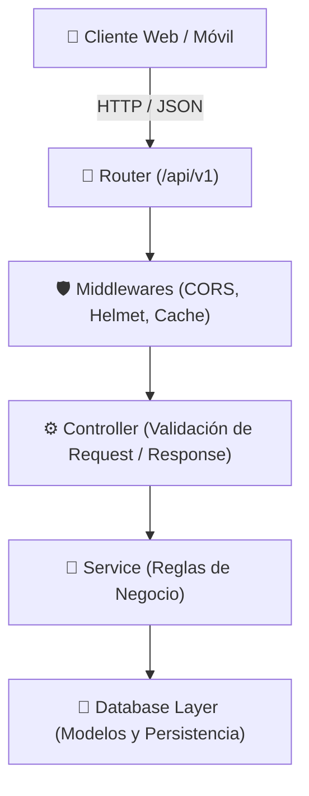

<div align="center">

# 🏋️ Gym Management RESTful API
### *Arquitectura Modular en 3 Capas con TypeScript, Express y Versionado de Endpoints*

[](https://www.typescriptlang.org/)
[](https://nodejs.org/)
[](https://expressjs.com/)
[](https://swagger.io/)
[](https://helmetjs.github.io/)

<p align="center">
  Backend robusto y desacoplado para centros deportivos y gimnasios, orientado a la gestión de entrenamientos (workouts) y marcas de rendimiento de atletas (records). Implementado siguiendo estrictamente los principios de <b>Clean Architecture</b> y diseño orientado a contratos.
</p>

</div>

---

## 🏗️ Arquitectura de la API (3 Capas)

La API sigue un patrón de diseño en capas estricto para garantizar que la lógica de negocio, el transporte HTTP y la persistencia de datos sean completamente independientes y testeables:



---

## 🚀 Puntos Fuertes de Ingeniería

- **Arquitectura de Capas Limpia:** Separación absoluta entre `Controller`, `Service` y `Database`.
- **Versionado de API:** Prefijo modular `/api/v1` para garantizar compatibilidad hacia atrás en futuras iteraciones.
- **Seguridad Integrada:** Cabeceras HTTP endurecidas mediante **Helmet** y control granular de orígenes con **CORS**.
- **Caché Inteligente:** Integración de **apicache** en memoria para optimizar lecturas recurrentes y reducir la latencia de respuesta.
- **Tipado Fuerte Estricto:** Contratos de datos modelados con TypeScript y ejecución reactiva con `tsx watch`.

---

## 📡 Especificación de Endpoints (`/api/v1`)

### 🏋️ Módulo de Entrenamientos (Workouts)

| Método | Endpoint | Descripción | Parámetros / Body |
| :--- | :--- | :--- | :--- |
| `GET` | `/api/v1/workouts` | Obtiene el listado completo de entrenamientos | `mode` (opcional) |
| `GET` | `/api/v1/workouts/:workoutId` | Detalle de un entrenamiento específico | `workoutId` (UUID) |
| `POST` | `/api/v1/workouts` | Da de alta un nuevo entrenamiento | JSON (name, mode, exercises...) |
| `PATCH` | `/api/v1/workouts/:workoutId` | Actualización parcial de datos | JSON con campos a modificar |
| `DELETE` | `/api/v1/workouts/:workoutId` | Elimina un entrenamiento | `workoutId` (UUID) |
| `GET` | `/api/v1/workouts/:workoutId/records` | Marcas registradas para un entrenamiento | `workoutId` (UUID) |

### 🏆 Módulo de Marcas & Rendimiento (Records)

| Método | Endpoint | Descripción | Parámetros |
| :--- | :--- | :--- | :--- |
| `GET` | `/api/v1/records` | Listado histórico de marcas y marcas personales | Filtros opcionales |
| `GET` | `/api/v1/records/:recordId` | Detalle de un récord deportivo | `recordId` (UUID) |

---

## 💻 Puesta en Marcha en Local

### 1. Clonar el repositorio
```bash
git clone https://github.com/EduardoCruzmunioz/ApiRestGymV2.git
cd ApiRestGymV2
```

### 2. Instalar dependencias
```bash
npm install
```

### 3. Configurar variables de entorno
Crea un archivo `.env` en la raíz (puedes basarte en la configuración de `src/config/env.ts`):
```env
PORT=3000
```

### 4. Iniciar en modo desarrollo (Hot-Reload)
```bash
npm run dev
```
La API estará disponible y respondiendo en: `http://localhost:3000/api/v1/workouts`.

---

## 📂 Estructura del Proyecto

```text
ApiRestGymV2/
├── data/                    # Almacenamiento y esquemas de datos mock/persistentes
├── src/
│   ├── config/              # Gestión de variables de entorno tipadas
│   ├── controller/          # Manejadores de petición y respuesta HTTP
│   ├── database/            # Capa de acceso a datos y operaciones CRUD
│   ├── services/            # Lógica de negocio y reglas de dominio
│   ├── types/               # Definiciones e interfaces de TypeScript
│   ├── utils/               # Utilidades de formateo y logging
│   ├── v1/
│   │   └── routes/          # Definición modular de rutas de la versión 1
│   └── index.ts             # Servidor Express principal y orquestación de middlewares
├── package.json
├── tsconfig.json
└── README.md
```

---

## 👨‍💻 Autor

Desarrollado por **Eduardo Cruz Muñoz**  
- **Portfolio:** [eduardocruzdev.netlify.app](https://eduardocruzdev.netlify.app/)  
- **LinkedIn:** [linkedin.com/in/eduardo-cruz-muñoz2202](https://www.linkedin.com/in/eduardo-cruz-mu%C3%B1oz2202/)  
- **GitHub:** [@EduardoCruzmunioz](https://github.com/EduardoCruzmunioz)
